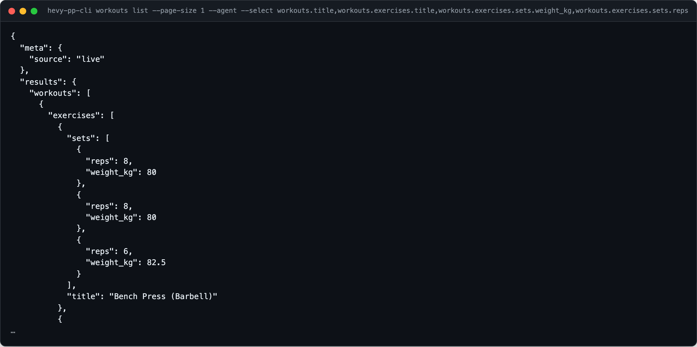
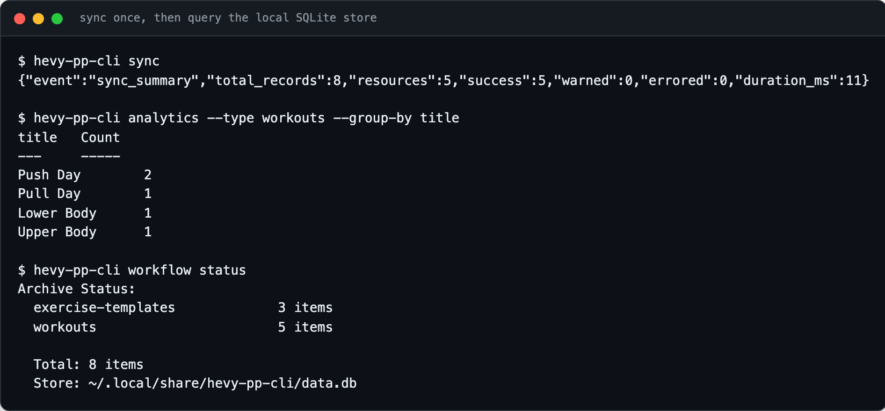

<div align="center">

<h1>hevy-pp-cli</h1>

<p><b>Your Hevy workouts, from the terminal.</b></p>

<p><i>Hevy has a public API but no command line. This is one, built for scripts and AI agents.</i></p>

<h6>


</h6>

<a href="#how-it-works"><b>How it works</b></a> ·
<a href="#features"><b>Features</b></a> ·
<a href="#build-it"><b>Build it</b></a> ·
<a href="#usage"><b>Usage</b></a>

<br><br>



<sub>Real output from the CLI, run against a local mock of the Hevy API serving demo workouts. Trimmed after the first exercise.</sub>

</div>

<br>

## The problem

Hevy logs every set you lift, and Hevy Pro accounts get an API key for it. Getting at that
data still means writing HTTP calls, handling pagination and keeping the key somewhere safe.
`hevy-pp-cli` wraps all 22 endpoints of the Hevy v1 API in one Go binary, with JSON output
an agent can parse, a local SQLite copy for offline queries, and an MCP server for Claude
Desktop and other MCP clients. Hevy describes its API as early and subject to change; this
project is not affiliated with Hevy.

## How it works

<table>
<tr>
<td width="33%" valign="top">

**1 · Add your key**

Get an API key at `hevy.com/settings?developer` (Hevy Pro only) and set `HEVY_API_KEY`,
or save it with `auth set-token`. `doctor` checks it.

</td>
<td width="33%" valign="top">

**2 · Ask the API**

Workouts, routines, folders, exercise templates, exercise history, body measurements and
your profile. Reads, creates and updates, with `--dry-run` to preview any request.

</td>
<td width="33%" valign="top">

**3 · Keep a local copy**

`sync` pulls your account into SQLite. `search`, `analytics` and `--data-source local`
then work without the network.

</td>
</tr>
</table>

## Offline, after one sync

<div align="center">



<sub>Real output against the same demo data. The store path is shown as <code>~</code>.</sub>

</div>

## Features

- **Every endpoint.** Workouts, routines, routine folders, exercise templates, exercise history, body measurements and user info: 22 operations from Hevy's OpenAPI spec.
- **Agent mode.** `--agent` turns on JSON, compact output, no prompts, no colour and `--yes` in one flag.
- **Small answers.** `--select` keeps only the fields you name, with dotted paths into nested sets.
- **Provenance on every read.** JSON is wrapped in `{"meta": {"source": "live" | "local"}, "results": ...}`.
- **Local SQLite store.** `sync` mirrors your account, with incremental, `--since` and `--full` modes; `search` runs FTS5 over it.
- **Safe writes.** `--dry-run` prints the exact request; `import` replays a JSONL file as creates.
- **MCP server.** `hevy-pp-mcp` exposes the 22 operations plus local `search`, read-only `sql` and `context` as 25 MCP tools.
- **Agent skill.** [`SKILL.md`](SKILL.md) teaches an agent the commands, flags and exit codes.
- **Scriptable plumbing.** Saved flag profiles, `--deliver file:` or `webhook:` output, `tail <resource>` polling as NDJSON, and fixed exit codes.

## Build it

Not yet published to the Printing Press library, so build from source. Requires Go 1.26.

```bash
git clone https://github.com/parthchandak02/hevy-pp-cli.git
cd hevy-pp-cli
make build-all                     # bin/hevy-pp-cli and bin/hevy-pp-mcp
export HEVY_API_KEY="<your-key>"   # or: bin/hevy-pp-cli auth set-token <key>
bin/hevy-pp-cli doctor             # checks config, key and API reachability
```

`make install` and `make install-mcp` put the binaries on your `GOPATH/bin` instead.

## Usage

```bash
hevy-pp-cli workouts list --page-size 10             # latest workouts (max 10 per page)
hevy-pp-cli workouts get-v1-count                    # total workouts on the account
hevy-pp-cli exercise-history <templateId>            # every logged set of one exercise
hevy-pp-cli exercise-templates list --all            # all exercises, built-in and custom
hevy-pp-cli body-measurements list --agent           # measurements as JSON
hevy-pp-cli sync && hevy-pp-cli search "squat"       # mirror locally, then search offline
```

Anything that can change your account (`post-v1`, `put-v1-*`, `import`) accepts `--dry-run`.

<details>
<summary><b>All commands</b></summary>

Each resource command also has a `list` alias for its `get-v1` subcommand.

| Command | |
|---|---|
| `workouts get-v1` | Paginated list of workouts (`--page`, `--page-size`, `--all`) |
| `workouts get-v1-count` | Total number of workouts on the account |
| `workouts get-v1-events` | Workout updates and deletes since a date, newest first |
| `workouts get-v1-workoutid` | One workout's full details |
| `workouts post-v1` / `put-v1-workoutid` | Create or update a workout |
| `routines get-v1` / `get-v1-routineid` | List routines, or get one by id |
| `routines post-v1` / `put-v1-routineid` | Create or update a routine |
| `routine-folders get-v1` / `get-v1-folderid` | List folders, or get one by id |
| `routine-folders post-v1` | Create a folder (inserted at index 0) |
| `exercise-templates get-v1` / `get-v1-exercisetemplateid` | List templates, or get one by id |
| `exercise-templates post-v1` | Create a custom exercise |
| `exercise-history <templateId>` | Set history for one exercise (`--start-date`, `--end-date`) |
| `body-measurements get-v1` / `get-v1-date` | List measurements, or get one by date |
| `body-measurements post-v1` | Create an entry for a date (409 if one exists) |
| `body-measurements put-v1-date` | Overwrite an entry; omitted fields become null |
| `user` | Your Hevy profile |
| `sync` | Mirror the API into SQLite (`--full`, `--since 7d`, `--resources`, `--latest-only`) |
| `search <query>` | Full-text search over synced data |
| `analytics` | Count and group-by over synced data (`--type`, `--group-by`) |
| `workflow archive` / `workflow status` | Sync everything; show what is stored |
| `tail [resource]` | Poll the API and emit changes as NDJSON |
| `import <resource>` | Create records from a JSONL file |
| `api [interface]` | Browse endpoints by interface name |
| `which "<capability>"` | Find the command for a task in plain words |
| `auth setup` / `set-token` / `status` / `logout` | Manage the API key |
| `doctor` | Check config, credentials and connectivity |
| `profile save` / `list` / `show` / `delete` | Saved sets of flags, used with `--profile` |
| `feedback` | Record notes about the CLI locally |
| `agent-context` | JSON description of the CLI for agents |

</details>

<details>
<summary><b>Output flags and exit codes</b></summary>

In a terminal, reads print readable output; when piped, they print the JSON envelope.

| Flag | |
|---|---|
| `--json` | JSON output |
| `--agent` | `--json --compact --no-input --no-color --yes` |
| `--select a,b.c` | Keep only these fields; dotted paths descend into arrays |
| `--compact` | Key fields only |
| `--data-source auto\|live\|local` | Live API with local fallback (default), API only, or synced data only |
| `--dry-run` | Print the request without sending it |
| `--deliver file:<path>` / `webhook:<url>` | Send output to a file or URL |
| `--idempotent`, `--rate-limit`, `--timeout`, `--no-cache` | Request control |

Exit codes: `0` success, `2` usage error, `3` not found, `4` auth error, `5` API error,
`7` rate limited, `10` config error.

</details>

<details>
<summary><b>Configuration and files</b></summary>

| | |
|---|---|
| `HEVY_API_KEY` | Required. Sent as the `api-key` header |
| `HEVY_BASE_URL` | Optional. Overrides `https://api.hevyapp.com` |
| `~/.config/hevy-pp-cli/config.toml` | Saved key, base URL and static headers (`--config` to change) |
| `~/.local/share/hevy-pp-cli/data.db` | Local SQLite store written by `sync` |
| `~/.local/share/hevy-pp-cli/feedback.jsonl` | Local feedback notes; never sent unless you opt in |

If you use agentcookie to sync secrets across machines, the CLI picks up the key it writes
(see [`agentcookie.toml`](agentcookie.toml)); `doctor` reports it as detected.

</details>

<details>
<summary><b>Use with agents and Claude Desktop</b></summary>

**Agent skill.** [`SKILL.md`](SKILL.md) is the `pp-hevy` skill. Copy it into your agent's
skills folder, for example `~/.claude/skills/pp-hevy/SKILL.md` for Claude Code, with
`hevy-pp-cli` on your `PATH`.

**MCP server.** Register the built binary with any MCP client:

```bash
claude mcp add hevy-pp-mcp -- hevy-pp-mcp
```

Or add it to Claude Desktop's `claude_desktop_config.json`:

```json
{
  "mcpServers": {
    "hevy": {
      "command": "hevy-pp-mcp",
      "env": { "HEVY_API_KEY": "<your-key>" }
    }
  }
}
```

[`manifest.json`](manifest.json) describes an MCPB bundle that asks for the key on install.

</details>

<details>
<summary><b>Project layout</b></summary>

```
cmd/hevy-pp-cli/     CLI entry point
cmd/hevy-pp-mcp/     MCP server entry point
internal/cli/        One file per command, plus sync, search, analytics and output helpers
internal/client/     HTTP client: auth header, retries, rate limiting, caching
internal/store/      SQLite store behind sync, search and offline reads
internal/mcp/        MCP tool definitions generated from the command tree
spec.json            Hevy's OpenAPI spec the CLI was generated from
SKILL.md             Agent skill
AGENTS.md            Notes for agents working in this repo
```

</details>

<br>

<div align="center">
<sub>Generated with <a href="https://github.com/mvanhorn/cli-printing-press">CLI Printing Press</a> from Hevy's OpenAPI spec. Built with Go, Cobra, SQLite and mcp-go.</sub>
</div>
